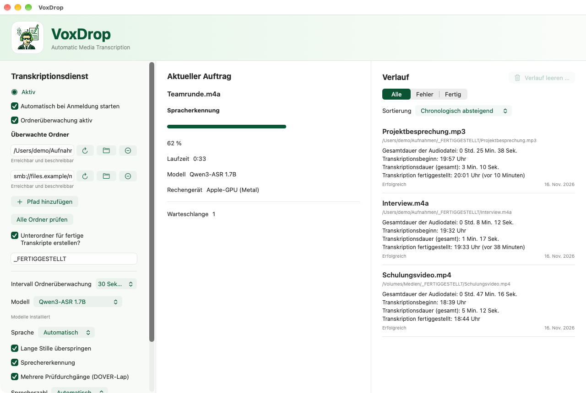
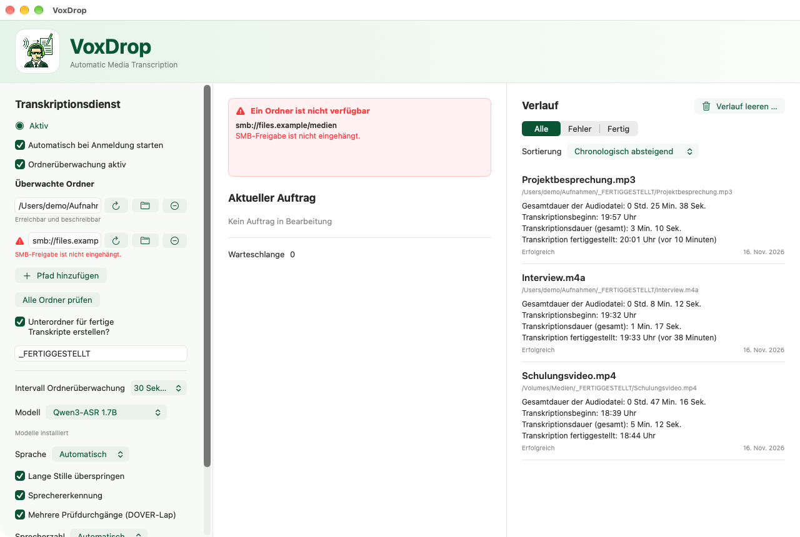
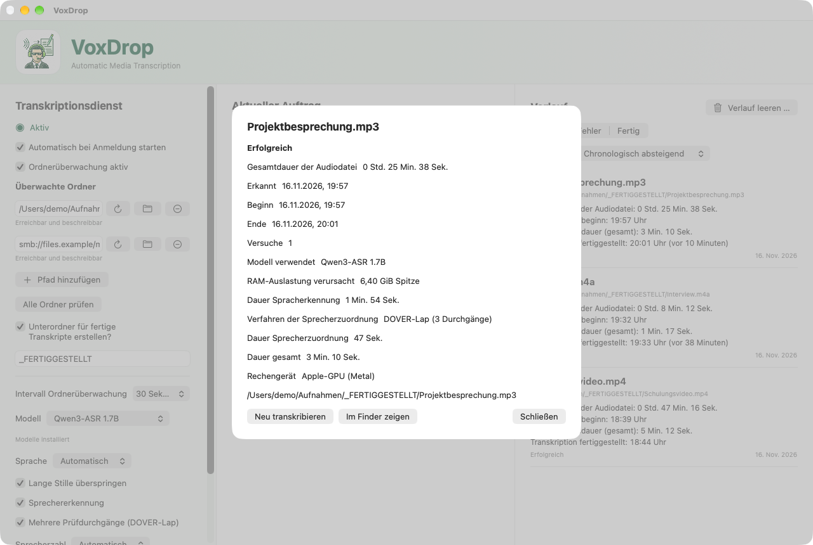

# VoxDrop

Automatic Media Transcription

VoxDrop ist eine macOS-App zur lokalen Transkription von Audio- und Videodateien. Sie überwacht mehrere lokale Ordner oder eingehängte SMB-Freigaben und erstellt UTF-8-Textdateien mit Zeitstempeln und optionaler Sprecherzuordnung.

## Installation

VoxDrop 1.0.0 benötigt Apple Silicon und macOS 26.2 oder neuer. Der aktuelle DMG-Build liegt als GitHub-Release-Entwurf vor und ist ad-hoc signiert. Die Apple-Notarisierung steht aus. [GitHub-Releases](https://github.com/adriantagonist87/VoxDrop/releases)

1. Die DMG öffnen und VoxDrop in den Ordner **Programme** ziehen. Vor einem Upgrade die laufende App mit **⌘Q** beenden.
2. In VoxDrop ein Modell wählen und auf **Modelle herunterladen** klicken. Mit aktivierter Sprechererkennung wird das Sprechermodell mitgeladen. Der einmalige Download benötigt Internet. Die Verarbeitung der Aufnahmen erfolgt lokal.
3. Unter **Überwachte Ordner** einen oder mehrere Ordner hinzufügen, **Ordnerüberwachung aktiv** einschalten und **Dienst starten** wählen. Für SMB muss die Freigabe eingehängt sein. Bei einer macOS-Abfrage den Zugriff auf Netzwerkvolumes erlauben.

Einstellungen, Verlauf und heruntergeladene Modelle liegen unter `~/Library/Application Support/VoxDrop`. VoxDrop übernimmt diese Daten und die Konfiguration für den Anmeldestart aus früheren Installationen.

## Ordner und Ausgabe



*Hauptfenster mit einem lokalen und einem SMB-Ordner, einem aktiven Auftrag und abgeschlossenen Aufträgen. Die Screenshots verwenden Beispieldaten.*

- Pfade lassen sich im Finder auswählen oder als absolute Pfade und `smb://server/freigabe/ordner` eingeben. VoxDrop prüft Erreichbarkeit und Schreibzugriff für jeden Ordner einzeln.
- Standardmäßig entsteht das Transkript als gleichnamige TXT neben der Originalaufnahme. Mit **Unterordner für fertige Transkripte erstellen?** landen Transkript und Originalaufnahme nach erfolgreichem Export im gewählten Unterordner. Der vorgeschlagene Name ist `_FERTIGGESTELLT`.
- Das Menüleistensymbol ist grün, wenn alle Ordner erreichbar und beschreibbar sind. Bei einem Fehler zeigt VoxDrop eine Warnung im Fenster und neben dem betroffenen Pfad. Die Schaltfläche neben dem Pfad prüft ihn sofort erneut. Nach der macOS-Freigabe kann VoxDrop auch eine Mitteilung anzeigen.
- Der Zustand der übrigen Ordner wird unabhängig geprüft. Beim Start prüft der Dienst fehlende Verbindungen nach weiteren 10, 30 und 60 Sekunden. Danach gilt das eingestellte **Intervall Ordnerüberwachung**.



*Ordnerwarnung mit einer weiterhin verfügbaren lokalen Quelle.*

## Transkription und Verlauf

Standardmodell ist **Qwen3-ASR 1.7B**. **Whisper Large v3 Turbo** ist im selben Menü auswählbar. Die Sprecherzuordnung verwendet pyannote. Die Sprecherzahl kann automatisch ermittelt oder vorgegeben werden. **Mehrere Prüfdurchgänge (DOVER-Lap)** kombiniert drei Durchgänge der Sprecherzuordnung. **Lange Stille überspringen** lässt längere Pausen bei der Spracherkennung aus. Die Zeitstempel beziehen sich auf die ursprüngliche Aufnahme.

Der **Verlauf** lässt sich filtern und chronologisch in beide Richtungen sortieren. Die Auftragsdetails zeigen die Länge der Aufnahme, Modell, Rechengerät, gemessene RAM-Spitze und die Dauer von Spracherkennung, Sprecherzuordnung und Verarbeitung. **Neu transkribieren** erstellt mit den aktuellen Einstellungen eine zusätzliche TXT. **Verlauf leeren …** setzt Auftragsdaten und bekannte Dateiversionen nach Bestätigung zurück. Aufnahmen und exportierte TXT-Dateien bleiben erhalten.



*Auftragsdetails einer abgeschlossenen Transkription.*

## Entwicklung

Die SwiftUI-Oberfläche startet einen lokalen Python-Dienst. Die Auftragsdaten liegen in SQLite. Qwen verarbeitet die Tonspur in Abschnitten von ungefähr 80 Sekunden und verwendet Qwen3-ForcedAligner zur Wortzeitausrichtung. Whisper verwendet CTranslate2. Die Sprecherzuordnung arbeitet auf der Zeitachse der gesamten Aufnahme.

```sh
sh scripts/bootstrap.sh
PY=.runtime/aTrain/.venv/bin/python
"$PY" -m unittest discover -s tests -v
"$PY" voxdrop.py setup-models
sh scripts/build-app.sh
sh scripts/build-dmg.sh
```

App-Bundle und DMG liegen in `.runtime/package`. `sh scripts/install-app.sh` installiert das lokal gebaute Bundle. Zum Testen eines Einzellaufs lässt sich mit `say` eine Prüfaufnahme erzeugen.

```sh
mkdir -p .runtime/testmedia
say -v Anna -o .runtime/testmedia/Pruefaufnahme.aiff \
  'Dies ist eine synthetische Prüfaufnahme.'
"$PY" voxdrop.py transcribe .runtime/testmedia/Pruefaufnahme.aiff \
  --output-dir .runtime/testmedia --language de --speaker-count 1
```

## Komponenten und Lizenzen

- **aTrain** stellt Teile der Audioverarbeitung und Sprecherzuordnung bereit und steht unter AGPL‑3.0-or-later. Die DMG enthält das Quellarchiv der verwendeten Revision. [aTrain-Quellstand](https://github.com/aTrainTranscription/aTrain/tree/ea8a7057857220b4299c0ba0b2aaf6def2f35b87)
- **Qwen3-ASR** und **Qwen3-ForcedAligner** stehen laut Modellkarten unter Apache-2.0. [Qwen3-ASR](https://huggingface.co/Qwen/Qwen3-ASR-1.7B) · [Qwen3-ForcedAligner](https://huggingface.co/Qwen/Qwen3-ForcedAligner-0.6B)
- Das **Whisper-Modell** steht laut aTrain-Modellregister unter MIT und das **Sprechermodell** unter CC BY 4.0. [Whisper-Modell](https://huggingface.co/aTrain-core/faster-whisper-large-v3-turbo/tree/df99141c9f5db0615d025664cff8949373a69593) · [Sprechermodell](https://huggingface.co/aTrain-core/speaker-detection/tree/027e7a80b40a5e3e69cb83ccf901725b59a4063d)
