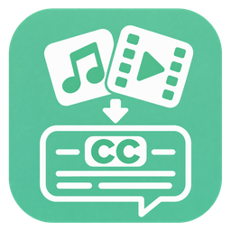

# VoxDrop

VoxDrop ist eine kostenlose App für macOS und Windows auf Basis von aTrain. Sie überwacht lokale Ordner und eingebundene SMB-Freigaben und transkribiert neue Audio- und Videodateien automatisch auf dem eigenen Rechner. Das Transkript wird als TXT neben der Aufnahme oder zusammen mit ihr in einem Unterordner gespeichert.

[Kostenloser Download für Windows und macOS](https://github.com/adriantagonist87/VoxDrop/releases/latest)

Voraussetzung für die Mac-Version ist ein Mac mit Apple Silicon und macOS 26.2 oder neuer.

Die DMG öffnen, den gesamten Ordner **VoxDrop** nach **Programme** ziehen und darin **VoxDrop.app** öffnen. Beim ersten Start kann macOS eine Bestätigung unter **Systemeinstellungen → Datenschutz & Sicherheit → Dennoch öffnen** verlangen. Der Download ist ad hoc signiert. [Apples Anleitung](https://support.apple.com/de-de/102445)

Über **Modelle herunterladen** werden die gewünschten Modelle und ihr Download-Cache im Programmordner unter **VoxDrop/Modelle** eingerichtet. Zum Entfernen der App samt Modellen den gesamten Ordner **VoxDrop** löschen. Bei Updates die neue **VoxDrop.app** in den vorhandenen VoxDrop-Ordner kopieren. Einstellungen und Verlauf liegen im Benutzerordner unter **Library/Application Support/VoxDrop**.

Der aktuelle native Windows-Prüfstand ist [Preview 13](https://github.com/adriantagonist87/VoxDrop/releases/tag/v1.3.2-windows-preview.13) mit X zum Systemtray, Minimieren zur Taskleiste und vollständigem App-/Überwachungs-/Modellstopp über „VoxDrop beenden“, transparentem App-Icon, getrenntem Verarbeitungsverlauf/Bestand und vollständiger Auftrags-/Suchdatenbereinigung. [Fensterbedienung und Beenden](docs/FENSTER_TRAY_UND_TASKLEISTE.md). Der gemeinsame macOS-Funktionsstand wartet noch auf die native Gegenprüfung; die stabile Mac-Ausgabe bleibt oben verlinkt.

Die Windows-Ausgabe richtet sich an Windows 11 x64 mit NVIDIA-RTX-GPU. [VoxDrop für Windows](windows/README.md)

Für die gemeinsame Weiterentwicklung gelten die Arbeitsregeln sowie Projektstatus und Entwicklungsanleitung. [AGENTS.md](AGENTS.md) · [Projektstatus](docs/PROJEKTSTATUS.md) · [Entwicklung](docs/ENTWICKLUNG.md) · [Windows-Übergabe](docs/UEBERGABE_WINDOWS.md)

## Modelle und Funktionen

- **Qwen3-ASR 1.7B** ist das Standardmodell. **Whisper Large v3 Turbo** ist als Alternative auswählbar.
- Transkripte mit Zeitstempeln und optionaler Sprecherzuordnung über pyannote. DOVER-Lap kann drei Durchgänge der Sprecherzuordnung zusammenführen.
- Lange Sprechpausen überspringen und Aufträge aus dem Verlauf mit anderen Einstellungen erneut transkribieren.
- Start bei der Anmeldung, Menüleistenstatus und Hinweise bei unerreichbaren oder schreibgeschützten Ordnern.
- Gemeinsame dunkelgraue Oberfläche mit verstellbaren Spalten für Einstellungen, aktuellen Auftrag und Verlauf.
- **Unterordner mit einbeziehen** erweitert die Überwachung auf verschachtelte Ordner. Die TXT-Dateien landen direkt neben den Aufnahmen.
- Ordner lassen sich für eine einmalige Transkription ins Fenster ziehen. VoxDrop reiht die Aufnahmen samt Unterordnern ein und legt die TXT-Dateien neben den Originalen ab.

## Benchmark auf einem Mac mini M5 Pro

Je ein Lauf pro Modell und Aufnahme auf der Apple-GPU eines Mac mini mit M5 Pro und 64 GB gemeinsamem Speicher. Die Gesamtzeit umfasst Dekodierung, Modellladen, Transkription, Zeitabgleich und die gemeinsame Sprecheranalyse mit pyannote. Der RAM-Wert ist die physische Spitzenbelegung des jeweiligen Spracherkennungsprozesses.

| Aufnahme | Audiodauer (Std:Min:Sek) | Qwen gesamt (Min:Sek) | Qwen RAM | Whisper gesamt (Min:Sek) | Whisper RAM |
| --- | ---: | ---: | ---: | ---: | ---: |
| Telefon | 0:48:19 | 3:48 | 5,28 GiB | 4:22 | 7,34 GiB |
| Raum | 1:58:02 | 9:35 | 5,09 GiB | 12:58 | 25,06 GiB |
| Video | 2:48:03 | 12:17 | 5,13 GiB | 17:26 | 30,10 GiB |

## Lizenzhinweise

VoxDrop steht unter der GNU Affero General Public License Version 3 (AGPL-3.0-only). [Lizenztext für VoxDrop](LICENSE)

Die eingebundene aTrain-Version steht unter AGPL-3.0-or-later. Bei der Weitergabe der DMG ist der zugehörige Quellcode gemäß § 6 der AGPL bereitzustellen. [aTrain-Quellstand](https://github.com/aTrainTranscription/aTrain/tree/ea8a7057857220b4299c0ba0b2aaf6def2f35b87) · [Lizenztext](https://spdx.org/licenses/AGPL-3.0-or-later.html)

Die Oberfläche verwendet Qt und Qt for Python. Der entsprechende Quellcode steht bei den Release-Downloads bereit. [Lizenzhinweise](desktop/Qt-Lizenzen.md)

Qwen3-ASR und der Forced Aligner stehen unter Apache-2.0, Whisper unter MIT und das Sprechermodell unter CC BY 4.0. [Qwen3-ASR](https://huggingface.co/Qwen/Qwen3-ASR-1.7B) · [Forced Aligner](https://huggingface.co/Qwen/Qwen3-ForcedAligner-0.6B) · [Whisper](https://huggingface.co/aTrain-core/faster-whisper-large-v3-turbo) · [Sprechermodell](https://huggingface.co/aTrain-core/speaker-detection)
