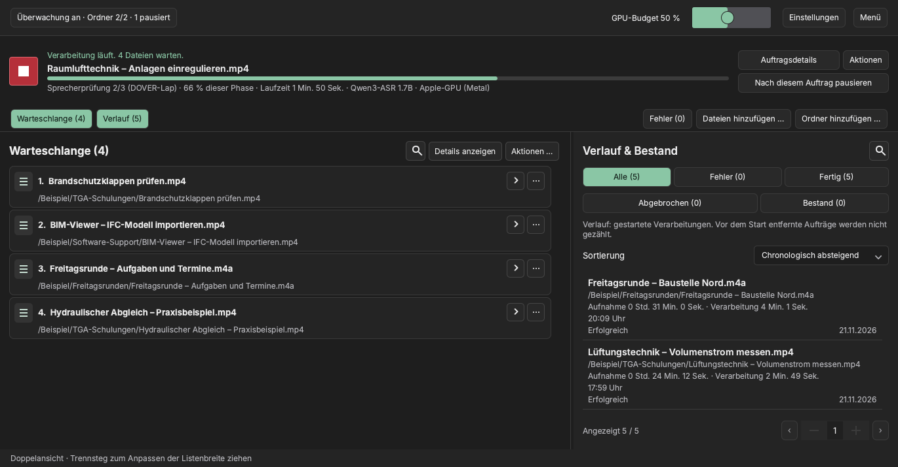
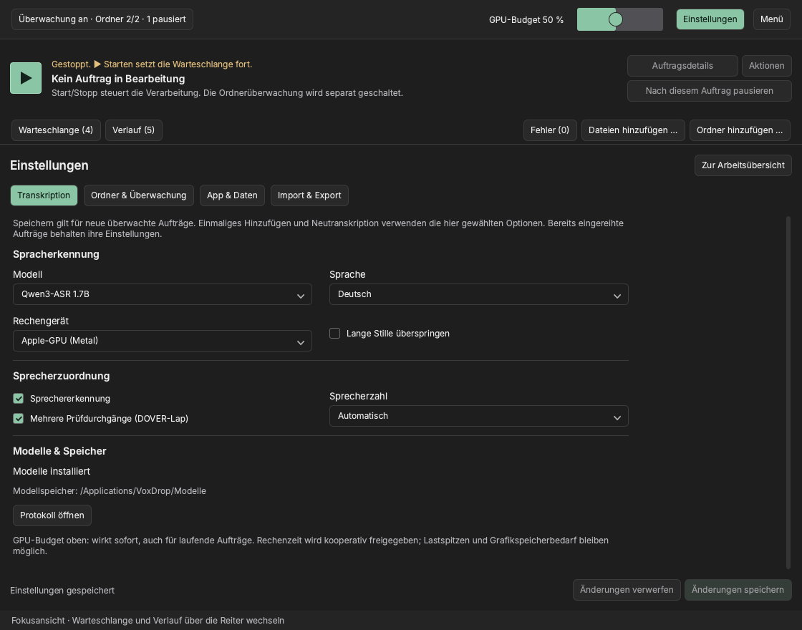
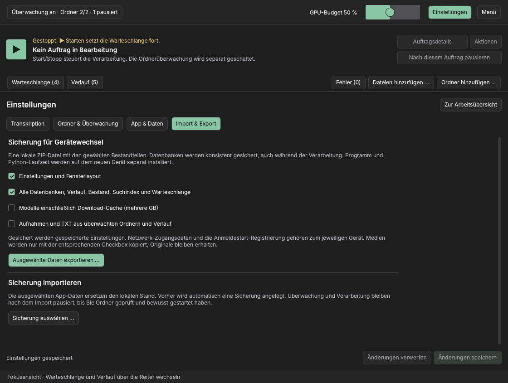

# VoxDrop

VoxDrop macht aus Audio- und Videoaufnahmen durchsuchbare Textdateien. So kannst du eine Besprechung, ein Interview oder eine Sprachnachricht später nachlesen und gezielt nach einer Stelle suchen. Die Transkription läuft auf deinem Mac oder Windows-PC. Deine Aufnahmen bleiben bei dir.

VoxDrop wird für macOS und Windows parallel mit demselben Funktionsumfang entwickelt. Die Versionshinweise zeigen den Stand der jeweiligen Downloads.

**[Für macOS herunterladen](https://github.com/adriantagonist87/VoxDrop/releases/download/v1.5.0-macos/VoxDrop-1.5.0-macOS-arm64.dmg)** · **[Für Windows herunterladen](https://github.com/adriantagonist87/VoxDrop/releases/download/v1.4.1/VoxDrop-1.4.1-Windows-x64.zip)** · [Alle Versionen](https://github.com/adriantagonist87/VoxDrop/releases)

## Was VoxDrop kann

- **Dateien und Ordner ablegen.** Zieh eine Aufnahme oder einen ganzen Ordner ins Fenster. VoxDrop nimmt auch Dateien aus Unterordnern auf und speichert die TXT-Dateien neben den Originalen. Unterstützt werden unter anderem MP3, M4A, WAV, OPUS, MP4 und MOV.
- **Eingänge automatisch überwachen.** Lass einen oder mehrere lokale Ordner oder eingebundene Netzwerkordner prüfen. VoxDrop wartet, bis eine neue Datei stabil ist. Du kannst Ordner einzeln pausieren und die Ausgabe pro Ordner festlegen. Auf Wunsch landen Aufnahme und TXT gemeinsam in einem Ordner für Fertiggestelltes.
- **Sprache, Zeitmarken und Sprecher erfassen.** Wähle zwischen Qwen3-ASR 1.7B und Whisper Large v3 Turbo. VoxDrop erkennt die Sprache auf Wunsch automatisch, kennzeichnet Sprecher und kann lange Stille überspringen. Die Zeitmarken beziehen sich weiterhin auf die Originalaufnahme.
- **Sprecher mit DOVER-Lap genauer zuordnen.** VoxDrop kombiniert drei Prüfdurchgänge. Das kann die Zuordnung bei häufigen Sprecherwechseln und gleichzeitigem Sprechen verbessern. Die zusätzliche Prüfung kostet Rechenzeit und kann mehr Speicher belegen.
- **GPU-Auslastung reduzieren.** Senke das GPU-Budget, wenn nebenbei etwa ein BIM-Modell oder ein Video geöffnet ist. VoxDrop gibt anderen Programmen Rechenzeit, auch während eines laufenden Auftrags. Die Verarbeitung dauert dafür länger. Der Regler steuert die Rechenzeit. Lastspitzen und Speicherbedarf hängen weiterhin vom Modell ab.
- **Aufträge steuern und Ergebnisse wiederfinden.** Ändere die Reihenfolge, halte die Verarbeitung an oder starte einen Auftrag erneut. Suche im Verlauf nach Dateinamen oder im Transkripttext. Eine erneute Transkription erhält eine eigene TXT-Datei.
- **Daten sichern und mitnehmen.** Unter **Einstellungen → Import & Export** kannst du Einstellungen, Verlauf und Warteschlange sichern. Modelle sowie Aufnahmen und TXT-Dateien lassen sich separat dazuwählen. Der Import zeigt dir vorab die enthaltenen Daten und lässt dich Ordner auf dem Zielgerät zuordnen.

## Ein Blick in die App

TGA-Schulungen, Software-Supportvideos und interne Freitagsrunden in einer Arbeitsübersicht. Alle Beispieldateien und angezeigten Auftragsdaten sind fiktiv.

Transkripte durchsuchen

Die Suche nach „Freigabe“ findet drei Transkripte, obwohl das Wort in keinem ihrer Dateinamen steht.

Verlauf und Auftragsdetails

Im Verlauf lassen sich Transkripte öffnen und Aufträge erneut ausführen. Die Details zeigen Modell, Dauer und das Verfahren der Sprecherzuordnung.

DOVER-Lap und GPU-Budget einstellen

Mehrere Ordner überwachen

Die TGA-Schulungen landen mit ihren TXT-Dateien im Zielunterordner. Bei den Supportvideos bleibt der Text neben der Quelle. Die Freitagsrunden sind vorübergehend pausiert.

Einstellungen, Verlauf und weitere Daten exportieren

## Installation

### macOS

**Apple Silicon, macOS 26.2 oder neuer.**

1. Lade die [DMG für macOS](https://github.com/adriantagonist87/VoxDrop/releases/tag/v1.5.0-macos) herunter und öffne sie im Finder.
2. Lege in **Programme** einen Ordner namens **VoxDrop** an. Öffne den Ordner **VoxDrop** in der DMG und kopiere **VoxDrop.app direkt** in den neu angelegten Ordner. Wirf die DMG aus und starte die App aus **Programme → VoxDrop**.
3. Falls macOS die App beim ersten Start blockiert, schließe die Meldung mit **Fertig**. Öffne **Systemeinstellungen → Datenschutz & Sicherheit**, wähle bei VoxDrop **Dennoch öffnen** und bestätige die Abfrage.
4. Öffne **Einstellungen → Transkription → Modelle herunterladen**. Als Modellspeicher soll **`/Applications/VoxDrop/Modelle`** angezeigt werden. Falls dort stattdessen der Benutzerordner steht, beende die App und prüfe die direkte Kopie aus Schritt 2.

### Windows

**Windows 11, 64 Bit.** Für die GPU-Beschleunigung brauchst du eine CUDA-fähige NVIDIA-Grafikkarte mit passendem Treiber. Getestet mit einer RTX 5060 mit 8 GB VRAM.

1. Lade die [ZIP für Windows](https://github.com/adriantagonist87/VoxDrop/releases/tag/v1.4.1) herunter und entpacke sie vollständig in einen lokalen Ordner, in den du schreiben kannst.
2. Öffne **`VoxDrop.exe`** im entpackten Ordner. Beim ersten Start richtet VoxDrop seine Laufzeit automatisch im Unterordner **Laufzeit** ein.
3. Öffne **Einstellungen → Transkription → Modelle herunterladen**. Die Modelle landen im Ordner **Modelle** neben der EXE.

Für die Einrichtung brauchst du Internet und mehrere Gigabyte freien Speicher. Sobald die Modelle eingerichtet sind, zieh eine Aufnahme ins Fenster und starte die Verarbeitung mit **▶**. Für die automatische Verarbeitung fügst du unter **Einstellungen → Ordner & Überwachung** einen Ordner hinzu und schaltest die Überwachung ein.

## Gemessene Laufzeit und Speichernutzung

| Testrechner | Modell und Einstellungen | Audiolänge | Verarbeitung | Gemessene Spitze |
| --- | --- | ---: | ---: | --- |
| Mac mini M5 Pro, 64 GB | Qwen, Metal, mit Sprecherzuordnung | 11 s | 23 s | 3,52 GiB RAM des Auftrags |
| Mac mini M5 Pro, 64 GB | Whisper, Metal, mit Sprecherzuordnung | 11 s | 11 s | 1,92 GiB RAM des Auftrags |
| Windows 11, RTX 5060, 8 GB | Qwen, CUDA, drei Sprecher-Prüfdurchgänge | 51,3 s | 35,5 s | 6,31 GiB VRAM gesamt |
| Windows 11, RTX 5060, 8 GB | Whisper, CUDA, drei Sprecher-Prüfdurchgänge | 51,3 s | 19,7 s | 6,54 GiB VRAM gesamt |
| Windows 11, RTX 5060, 8 GB | Qwen, CUDA, drei Sprecher-Prüfdurchgänge, Stille übersprungen | 48 min 55 s | 7 min 36 s | 7,29 GiB VRAM gesamt |

Die Mac-Kurztests stammen aus der Neuinstallation von **1.5.0**. Apple Silicon hat gemeinsamen Speicher für CPU und GPU. In einem separaten Qwen-Kurztest sank die gemessene GPU-Speicherspitze für Erkennung und Zeitmarken von **5,29 auf 3,58 GiB**, nachdem beide Schritte nacheinander ausgeführt wurden. [Mac-Messprotokoll](docs/MAC_ABNAHME_2026-11-21.md#direkter-qwen-speichervergleich)

Die Windows-Werte stammen aus früheren nativen Abnahmeläufen. Der VRAM-Wert umfasst auch den Desktop und andere laufende Programme. Die Testläufe verwendeten unterschiedliche Aufnahmen und Sprecheroptionen. [Windows-Kurztests](docs/PROJEKTSTATUS.md#abschließende-paket-dateiprüfungen-und-präzisierte-meldungen) · [Windows-Langtest](docs/WINDOWS_ABNAHME_2026-11-18.md)

### Was DOVER-Lap und ein kleineres GPU-Budget kosten

Auf dem **Mac mini M5 Pro** lief dieselbe 27,8 Sekunden lange Aufnahme mit Whisper auf Metal je dreimal pro Einstellung. In allen Läufen war die Sprecherzuordnung aktiv. Die Tabelle zeigt den jeweiligen Median.

| GPU-Budget | Sprecherzuordnung | Gesamtzeit | Davon Sprecherphase | RAM-Spitze des Auftrags |
| ---: | --- | ---: | ---: | ---: |
| 100 % | Ein Durchgang | 9,42 s | 6,23 s | 5,46 GiB |
| 100 % | Drei Durchgänge mit DOVER-Lap | 9,97 s | 6,81 s | 7,85 GiB |
| 50 % | Ein Durchgang | 11,96 s | 7,93 s | 5,64 GiB |

Bei dieser kurzen Aufnahme lieferten alle Varianten denselben Text mit denselben Sprecherlabels. Der Test misst Aufwand und Speicherbedarf. Wie stark DOVER-Lap die Sprecherzuordnung verbessert, hängt von der Aufnahme ab. [Mac-Messprotokoll](docs/PROJEKTSTATUS.md#messung-für-die-readme-dover-lap-und-gpu-budget) · [DOVER-Lap-Fachartikel](https://arxiv.org/abs/2011.01997)

Auf der **RTX 5060** sank die GPU-Auslastung bei kontrollierter Rechenlast von **92,4 %** auf **42,3 %**, als das Budget von 100 % auf 50 % gestellt wurde. Dabei sank der Durchsatz von **405 auf 191 Modellschritte pro Sekunde**. Wie viel länger die Transkription dauert, hängt auch davon ab, wie viel Zeit der Auftrag für Laden, Einlesen und andere Schritte benötigt. [Windows-Messprotokoll](docs/GPU_ARBEITSBUDGET.md#geprüfter-stand--windows-v134)

VoxDrop ist Open Source unter der [AGPL-3.0](LICENSE). [Hinweise für Entwickler](docs/ENTWICKLUNG.md) · [Qt-Lizenzhinweise](desktop/Qt-Lizenzen.md)
