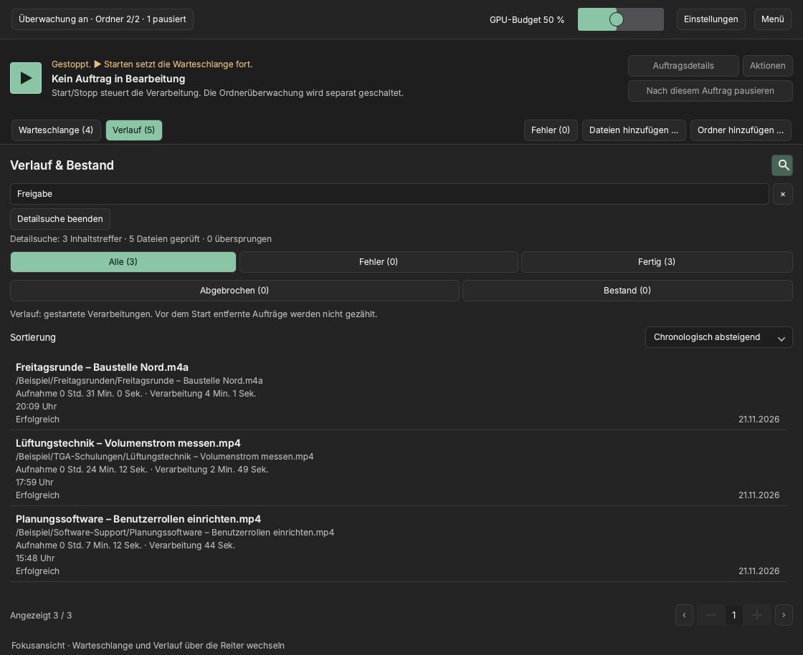
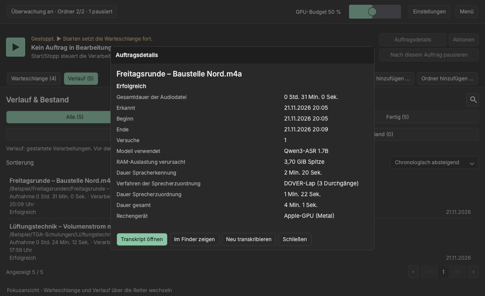
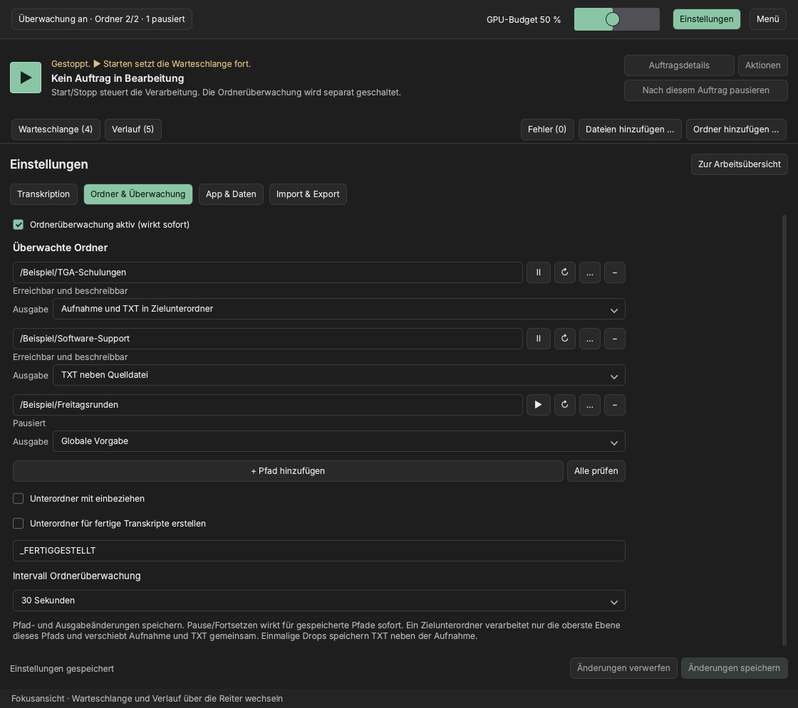
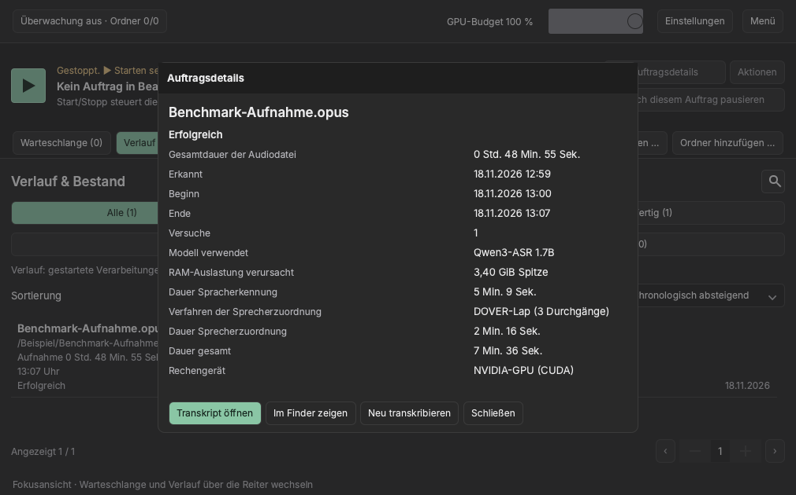

# VoxDrop

VoxDrop macht aus Audio- und Videoaufnahmen durchsuchbare Textdateien. So kannst du eine Besprechung, ein Interview oder eine Sprachnachricht später nachlesen und gezielt nach einer Stelle suchen. Die Transkription läuft auf deinem Mac oder Windows-PC. Deine Aufnahmen bleiben bei dir.

VoxDrop wird für macOS und Windows parallel mit demselben Funktionsumfang entwickelt. Die Versionshinweise zeigen den Stand der jeweiligen Downloads.

## Hardware und System

| Paket | Prozessor und Betriebssystem | GPU und Laufzeit |
| --- | --- | --- |
| macOS | Apple Silicon (ARM64), ab macOS 26.2 | Integrierte Apple-GPU mit Metal. CPU und GPU teilen sich den Arbeitsspeicher. |
| Windows | x64-PC mit Intel- oder AMD-Prozessor und Windows 11 | Für CUDA eine kompatible NVIDIA-GPU mit Treiber für CUDA 12.8. Getestet mit RTX 5060 und 8 GB VRAM. Die Laufzeit benötigt das [Visual C++ Redistributable für x64](https://learn.microsoft.com/de-de/cpp/windows/latest-supported-vc-redist). |

**RAM und Speicherplatz.** Als Richtwert für den Einstieg sind 16 GB Arbeitsspeicher sinnvoll. Eine allgemeine RAM- oder VRAM-Untergrenze wurde bisher nicht vermessen. Der Bedarf hängt von Modell, Audiolänge und Sprecheroptionen ab. Auf dem Mac belegten Programm, beide Modelle und Download-Cache zusammen rund 11,3 GiB. Plane freien Platz für die Einrichtung und zusätzlich für Arbeitskopien deiner Aufnahmen ein. Unter Windows lädt VoxDrop beim ersten Start auch die Laufzeit herunter.

Für die Ersteinrichtung brauchst du Internet und einen beschreibbaren Programmordner. Unter **Einstellungen → Transkription → Rechengerät** kannst du auch **CPU** wählen.

**[Für macOS herunterladen](https://github.com/adriantagonist87/VoxDrop/releases/download/v1.5.0-macos/VoxDrop-1.5.0-macOS-arm64.dmg)** · **[Für Windows herunterladen](https://github.com/adriantagonist87/VoxDrop/releases/download/v1.4.1/VoxDrop-1.4.1-Windows-x64.zip)** · [Alle Versionen](https://github.com/adriantagonist87/VoxDrop/releases)

## Was VoxDrop kann

- **Dateien und Ordner ablegen.** Zieh eine Aufnahme oder einen ganzen Ordner ins Fenster. VoxDrop nimmt auch Dateien aus Unterordnern auf und speichert die TXT-Dateien neben den Originalen. Unterstützt werden unter anderem MP3, M4A, WAV, OPUS, MP4 und MOV.
- **Eingänge automatisch überwachen.** Lass einen oder mehrere lokale Ordner oder eingebundene Netzwerkordner prüfen. VoxDrop wartet, bis eine neue Datei stabil ist. Du kannst Ordner einzeln pausieren und die Ausgabe pro Ordner festlegen. Auf Wunsch landen Aufnahme und TXT gemeinsam in einem Ordner für Fertiggestelltes.
- **Sprache, Zeitmarken und Sprecher erfassen.** Wähle zwischen Qwen3-ASR 1.7B und Whisper Large v3 Turbo. VoxDrop erkennt die Sprache auf Wunsch automatisch, kennzeichnet Sprecher und kann lange Stille überspringen. Die Zeitmarken beziehen sich weiterhin auf die Originalaufnahme.
- **Sprecher mit DOVER-Lap genauer zuordnen.** VoxDrop kombiniert drei Prüfdurchgänge. Das kann die Zuordnung bei häufigen Sprecherwechseln und gleichzeitigem Sprechen verbessern. Die zusätzliche Prüfung kostet Rechenzeit und kann mehr Speicher belegen.
- **GPU-Auslastung reduzieren.** Senke das GPU-Budget, wenn nebenbei etwa ein BIM-Modell oder ein Video geöffnet ist. VoxDrop gibt anderen Programmen Rechenzeit, auch während eines laufenden Auftrags. Die Verarbeitung dauert dafür länger. Der Regler steuert die Rechenzeit. Lastspitzen und Speicherbedarf hängen weiterhin vom Modell ab.
- **Aufträge steuern und Ergebnisse wiederfinden.** Ändere die Reihenfolge, halte die Verarbeitung an oder starte einen Auftrag erneut. Suche im Verlauf nach Dateinamen oder im Transkripttext. Eine erneute Transkription erhält eine eigene TXT-Datei.
- **Daten sichern und mitnehmen.** Unter **Einstellungen → Import & Export** kannst du Einstellungen, Verlauf und Warteschlange sichern. Modelle sowie Aufnahmen und TXT-Dateien lassen sich separat dazuwählen. Der Import zeigt dir vorab die enthaltenen Daten und lässt dich Ordner auf dem Zielgerät zuordnen.

## Ein Blick in die App

TGA-Schulungen, Software-Supportvideos und interne Freitagsrunden in einer Arbeitsübersicht. Alle Beispieldateien und angezeigten Auftragsdaten sind fiktiv.

Transkripte durchsuchen

Die Suche nach „Freigabe“ findet drei Transkripte, obwohl das Wort in keinem ihrer Dateinamen steht.

Verlauf und Auftragsdetails

Im Verlauf lassen sich Transkripte öffnen und Aufträge erneut ausführen. Die Details zeigen Modell, Dauer und das Verfahren der Sprecherzuordnung.

DOVER-Lap und GPU-Budget einstellen

Mehrere Ordner überwachen

Die TGA-Schulungen landen mit ihren TXT-Dateien im Zielunterordner. Bei den Supportvideos bleibt der Text neben der Quelle. Die Freitagsrunden sind vorübergehend pausiert.

Einstellungen, Verlauf und weitere Daten exportieren

## Installation

### macOS

1. Lade die [DMG für macOS](https://github.com/adriantagonist87/VoxDrop/releases/tag/v1.5.0-macos) herunter und öffne sie im Finder.
2. Lege in **Programme** einen Ordner namens **VoxDrop** an. Öffne den Ordner **VoxDrop** in der DMG und kopiere **VoxDrop.app direkt** in den neu angelegten Ordner. Wirf die DMG aus und starte die App aus **Programme → VoxDrop**.
3. Falls macOS die App beim ersten Start blockiert, schließe die Meldung mit **Fertig**. Öffne **Systemeinstellungen → Datenschutz & Sicherheit**, wähle bei VoxDrop **Dennoch öffnen** und bestätige die Abfrage.
4. Öffne **Einstellungen → Transkription → Modelle herunterladen**. Als Modellspeicher soll **`/Applications/VoxDrop/Modelle`** angezeigt werden. Falls dort stattdessen der Benutzerordner steht, beende die App und prüfe die direkte Kopie aus Schritt 2.

### Windows

1. Lade die [ZIP für Windows](https://github.com/adriantagonist87/VoxDrop/releases/tag/v1.4.1) herunter und entpacke sie vollständig in einen lokalen Ordner, in den du schreiben kannst.
2. Öffne **`VoxDrop.exe`** im entpackten Ordner. Beim ersten Start richtet VoxDrop seine Laufzeit automatisch im Unterordner **Laufzeit** ein.
3. Öffne **Einstellungen → Transkription → Modelle herunterladen**. Die Modelle landen im Ordner **Modelle** neben der EXE.

Sobald die Modelle eingerichtet sind, zieh eine Aufnahme ins Fenster und starte die Verarbeitung mit **▶**. Für die automatische Verarbeitung fügst du unter **Einstellungen → Ordner & Überwachung** einen Ordner hinzu und schaltest die Überwachung ein.

## Gemessene Laufzeit und Speichernutzung

**Zwischenstand: 15 von 16 Varianten abgeschlossen.** Neue Messwerte erscheinen nach jedem Lauf.

Messreihe mit **16 Kombinationen** auf derselben realen MP4-Aufnahme (20:59 min Audio) auf einem **Mac mini M5 Pro mit 64 GB**. VoxDrop 1.5.0 nutzt Metal mit Qwen3-ASR 1.7B und Whisper Large v3 Turbo. Jede Variante beginnt mit einem frischen Auftragsprozess. Die Sprechererkennung ist immer aktiv, mit einem Durchgang ohne DOVER-Lap und drei mit DOVER-Lap. Die Option „Lange Stille überspringen“ blieb aus.

| Modell | GPU-Budget | DOVER-Lap | Sprache | Gesamt | Echtzeitfaktor | Sprecherphase | RAM-Spitze | Ø GPU |
| --- | ---: | --- | --- | ---: | ---: | ---: | ---: | ---: |
| Whisper | 100 % | Aus | Deutsch | 2:16 min | 9,3× | 0:51 min | 5,75 GiB | 71,9 % |
| Whisper | 100 % | An | Automatisch | 2:48 min | 7,5× | 1:13 min | 5,72 GiB | 79,0 % |
| Whisper | 100 % | An | Deutsch | 2:35 min | 8,1× | 1:13 min | 5,79 GiB | 75,8 % |
| Whisper | 50 % | Aus | Automatisch | 4:21 min | 4,8× | 1:35 min | 5,97 GiB | 58,3 % |
| Whisper | 50 % | Aus | Deutsch | 4:16 min | 4,9× | 1:33 min | 5,99 GiB | 62,9 % |
| Whisper | 50 % | An | Automatisch | 5:16 min | 4,0× | 2:30 min | 5,88 GiB | 66,0 % |
| Whisper | 50 % | An | Deutsch | 5:23 min | 3,9× | 2:34 min | 5,96 GiB | 64,7 % |
| Qwen | 100 % | Aus | Automatisch | 2:07 min | 9,9× | 1:11 min | 5,65 GiB | 68,5 % |
| Qwen | 100 % | Aus | Deutsch | 1:36 min | 13,1× | 0:47 min | 5,64 GiB | 85,8 % |
| Qwen | 100 % | An | Automatisch | 2:06 min | 10,0× | 1:15 min | 5,67 GiB | 87,3 % |
| Qwen | 100 % | An | Deutsch | 2:06 min | 10,0× | 1:16 min | 5,72 GiB | 87,0 % |
| Qwen | 50 % | Aus | Automatisch | 11:23 min | 1,8× | 1:34 min | 5,91 GiB | 47,1 % |
| Qwen | 50 % | Aus | Deutsch | 11:14 min | 1,9× | 1:39 min | 5,90 GiB | 48,1 % |
| Qwen | 50 % | An | Automatisch | 12:01 min | 1,7× | 2:31 min | 5,86 GiB | 49,5 % |
| Qwen | 50 % | An | Deutsch | 12:08 min | 1,7× | 2:33 min | 5,90 GiB | 49,6 % |

**Gesamt** umfasst Dekodierung, Spracherkennung und Sprecherzuordnung aus der lokalen Kopie. **Echtzeitfaktor** ist Audiolänge geteilt durch Gesamtzeit. Bei 4× dauert die Verarbeitung ein Viertel der Aufnahmedauer. **RAM-Spitze** ist der höchste gemessene Speicherbedarf des Auftragsprozesses samt Kindprozessen. Der Mac teilt sich den Speicher zwischen CPU und GPU. **Ø GPU** ist der Mittelwert der gesamten Apple-GPU aus Stichproben im Abstand von rund zwei Sekunden. Das eingestellte GPU-Budget steuert die Rechenpausen von VoxDrop. Die Messreihe erfasst Laufzeit und Speicherbedarf. Die Transkriptionsqualität wurde nicht benotet.

### Auftragsdetails zum Langtest auf der RTX 5060

Frühere Windows-Messung mit einer anderen Aufnahme anzeigen

Die Auftragsdetails zeigen **7 min 36 s Verarbeitung** für **48 min 55 s Audio** mit Qwen und drei DOVER-Lap-Durchgängen. Die Anzeige nennt **3,40 GiB RAM** für den Auftrag. Beim selben Lauf erreichte die **gesamte Grafikkarte 7,29 GiB VRAM** in der höchsten Stichprobe. Der VRAM-Wert stammt aus einer separaten GPU-Messung und umfasst weitere Programme. [Messprotokoll](docs/WINDOWS_ABNAHME_2026-11-18.md#aktueller-paketstand-und-fortsetzung)

Nachgestellte Ansicht mit den Messwerten des echten Langtests. Dateiname und Uhrzeiten sind Beispiele.

Für die Aufnahme der Mac-Messreihe liegt kein Windows-Messwert vor. In einer früheren kontrollierten Messung auf der RTX 5060 senkte ein GPU-Budget von 50 % die durchschnittliche Auslastung von 92,4 % auf 42,3 %. [Windows-Messprotokoll](docs/GPU_ARBEITSBUDGET.md#geprüfter-stand--windows-v134)

VoxDrop ist Open Source unter der [AGPL-3.0](LICENSE). [Hinweise für Entwickler](docs/ENTWICKLUNG.md) · [Qt-Lizenzhinweise](desktop/Qt-Lizenzen.md)
