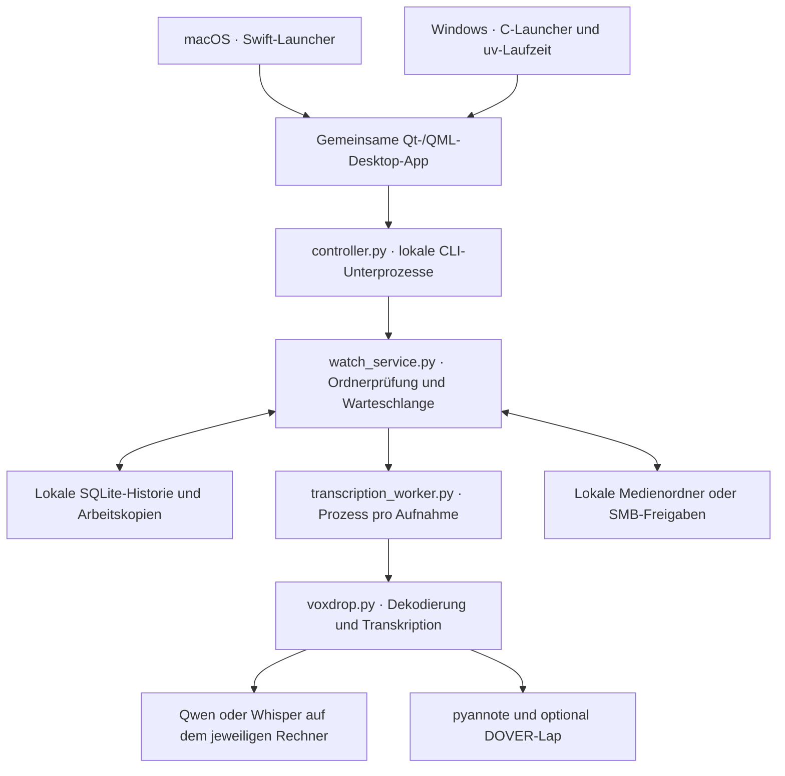

# Entwicklung auf macOS und Windows

Vor jeder Aufgabe gelten die verbindlichen Arbeitsregeln. Der Projektstatus enthält die nachgewiesenen Prüfstände und offenen Fehler. [Arbeitsregeln](../AGENTS.md) · [Projektstatus](PROJEKTSTATUS.md)

## Repository und Zusammenarbeit

Das gemeinsame Repository ist `https://github.com/adriantagonist87/VoxDrop.git`. Für einen neuen Rechner genügt ein normaler Clone.

```sh
git clone https://github.com/adriantagonist87/VoxDrop.git
cd VoxDrop
git fetch origin
git switch main
git status --short --branch
git rev-parse HEAD
```

`main` ist die gemeinsame geprüfte Basis für macOS und Windows. Neue Aufgaben beginnen auf dem aktuellen `origin/main`. Vorhandene Branches werden regulär ausgecheckt. In gemeinsam genutzten Arbeitskopien prüft Codex vor dem Wechsel lokale Änderungen.

```sh
git fetch origin
git switch main
git merge --ff-only origin/main
git switch -c fix/windows-start-diagnose
```

Commits und Statusupdates auf dem Aufgabenbranch machen Änderungen für den anderen Rechner nachvollziehbar. Nach Push folgt die Integration über den üblichen GitHub-Review-/Merge-Ablauf im beauftragten Umfang. Beim nächsten Codex-Lauf wird der Remote-Stand erneut abgeglichen.

Die Mac-Arbeitskopie wurde für diese Zusammenarbeit an die öffentliche Historie angebunden. Ihre frühere lokale Historie war zunächst im lokalen Branch `archive/macos-local-before-shared-github` gesichert. Bei der ausdrücklich beauftragten vollständigen Deinstallation einschließlich alter Arbeitskopien am 17.11.2026 wurde dieser lokale Branch entfernt und das Repository frisch von GitHub geklont. Für neue Arbeiten dienen `origin/main` und die freigegebenen Aufgabenbranches als gemeinsame Basis.

## Architektur und Rolle des Mac mini

Der Nutzer hat das Betriebsmodell am 17.11.2026 bestätigt. VoxDrop läuft als eigenständige macOS-App auf dem Mac mini und als eigenständige Windows-App beispielsweise auf einem Büro-PC in einem anderen Netzwerk. Jede App führt die KI-Verarbeitung auf ihrem eigenen Rechner aus und erreicht lokale Ordner beziehungsweise SMB-Freigaben aus ihrem jeweiligen Netzwerk.

Der Mac mini ist gleichzeitig Entwicklungs-, Test- und Build-Rechner. Die Bezeichnung „Mac als KI-Server“ ist für diesen Stand als lokale KI-Laufzeit einzuordnen. Die implementierte Schnittstelle zwischen Desktop-App und KI ist eine lokale Prozessschnittstelle. GitHub führt den gemeinsamen Quellstand zusammen.



- `desktop/desktop.py` startet Qt, Fenster und Einzelinstanz-Erkennung. `QLocalServer`/`QLocalSocket` dienen zum Wiederöffnen derselben lokalen Profilinstanz.
- `desktop/window_state.py` aktiviert das vorhandene Fenster und erhält dessen normalen, maximierten oder Vollbildmodus. Für erneutes Anzeigen `setVisible(True)` verwenden; `QWindow.show()` setzt auf Desktop-Systemen den Standardmodus und kann eine vorhandene Maximierung aufheben. Minimierte Fenster kehren in ihren zuletzt sichtbaren Modus zurück.
- `desktop/controller.py` ruft `watch_service.py` per `subprocess` auf. Einstellungen und Status werden als JSON übertragen.
- `watch_service.py` verwaltet Dateiversionen, SQLite-Aufträge, eine serielle Verarbeitung, Fehler, Wiederholungen und die Ergebnisveröffentlichung. Hängende Ordnerprüfungen sind in zeitbegrenzten Unterprozessen isoliert.
- `transcription_worker.py` führt eine Aufnahme im eigenen Prozess aus und misst Spitzenbelegung. Fortschrittsereignisse kommen über Standardausgabe mit dem Präfix `smb-transcription:`.
- `voxdrop.py` verwendet aTrain/PyAV für Audio, Qwen oder Whisper für ASR, optional pyannote und DOVER-Lap für Sprecher. `silence.py` hält die Rückrechnung der Zeitstempel bei ausgelassenen Pausen vor.
- `qwen_backend.py` startet den Qwen-Unterprozess. Auf macOS nutzt er MLX. Unter Windows verzweigt er in `qwen_cuda.py` mit Transformers/PyTorch.
- `smb_paths.py` und `platform_io.py` kapseln Pfadauflösung, Dateioperationen, Sperren und Prozessflags.

Die produktive Funktion kann bei geschlossenem Hauptfenster weiterlaufen. Die GUI liest den lokalen Dienststatus. Für geschlossene oder minimierte Fenster sind die native Wiederöffnung und das Statussymbol plattformspezifisch angebunden.

## Plattformabhängigkeiten

| Bereich | macOS | Windows |
| --- | --- | --- |
| Ziel | Apple Silicon, Bundle-Mindestversion macOS 26.2 | Windows 11 x64, NVIDIA RTX 5060 mit 8 GB oder kompatibel leistungsfähiger |
| App-Einstieg | `macos/Launcher.swift` lädt `libpython3.12.dylib` und ruft `Py_BytesMain` auf. Der native App-Prozess bleibt erhalten. | `windows/launcher.c` setzt Benutzerpfade, richtet per uv die gesperrte Laufzeit ein und startet `pythonw.exe`. `--diagnose` startet `python.exe`. |
| Gemeinsames GUI | PySide6 Essentials/Shiboken6 6.10.2, QML, Basic-Stil, gebündeltes Inter | Dieselben QML-/Controller-Dateien, **UNGEPRÜFT unter Windows** |
| Qwen | MLX-Audio 0.6.5, separate Qwen-Packages, Metal/CPU | Transformers 5.22.0, PyTorch 2.9.1+cu128, CUDA/CPU. ASR und Aligner werden nacheinander geladen. **UNGEPRÜFT unter Windows**. |
| Whisper | CTranslate2 4.9.0 aus `metal/`, Gerät `mps`, FP16 | CTranslate2 4.8.0, CUDA FP16, Torch-DLL-Pfad. **UNGEPRÜFT unter Windows**. |
| Modelle | `qwen-models.json` | `qwen-windows-models.json`, eigener Format-/Dateibestand |
| DOVER-Lap | Separate `.runtime/dover-packages`, NumPy-2-Anpassung im Bootstrap | Cross-Build übernimmt diese Packages und lädt den unbenutzten nativen DER-Import erst bei Bedarf. **UNGEPRÜFT unter Windows**. |
| Anmeldestart | `login_agent.py`, `~/Library/LaunchAgents/local.voxdrop.worker.plist`, App-Launcher mit `--background` für Menüleiste und Dienst | HKCU `Software\Microsoft\Windows\CurrentVersion\Run`, Wert `VoxDrop`, EXE mit `--background`. **UNGEPRÜFT unter Windows**. |
| SMB | Bereits eingehängte Freigabe, Auflösung über `/sbin/mount -t smbfs` | Netzlaufwerk, UNC oder SMB-URL mit Windows-Zugangsdaten. **UNGEPRÜFT unter Windows**. |
| Dateischutz | `fcntl`, `O_NOFOLLOW`, exklusives `renamex_np` | `msvcrt`, Reparse-Point-Prüfung, Windows-Prozessflags und Umbenennung. **UNGEPRÜFT unter Windows**. |
| RAM-Messung | Physischer Footprint über `proc_pid_rusage` | Prozess-RSS über psutil, **UNGEPRÜFT unter Windows**. Die Kennzahl ist plattformabhängig. |
| Pakete | Swift, AppKit/Icon-Werkzeuge, codesign, hdiutil, DMG | Vorhandener Build auf macOS mit Zig, Windows-EXE und portablem ZIP |

Linux ist eine offene Portierungsaufgabe. Die aktuelle Hardwareauswahl und mehrere POSIX-/macOS-Zweige benötigen dafür Anpassung und Zielsystemtests.

## Daten und Konfiguration

Das Desktop-Standardprofil liegt unter `~/Library/Application Support/VoxDrop` beziehungsweise `%LOCALAPPDATA%\VoxDrop`. Unter macOS liegen in einer Ordnerinstallation Modellgewichte und Download-Cache im gemeinsamen Programmordner unter `VoxDrop/Modelle`. Einstellungen, Verlauf und temporäre Medien bleiben im Benutzerprofil. Ein für die GUI gesetztes `VOXDROP_PROFILE` wählt ein isoliertes Profil samt eigenem Modellspeicher. `VOXDROP_MODEL_DATA` kann für einen gezielten Installationstest einen separaten Modellspeicher wählen. CLI-Werkzeuge erhalten die Pfade ausdrücklich über `--state-dir`, `--model-data` oder `--data-dir`.

| Pfad im Profil | Inhalt |
| --- | --- |
| `config.json` | Ordner und Verarbeitungseinstellungen |
| `layout.ini` | Spaltenbreiten und weitere GUI-Einstellungen |
| `data/models/` | Modellgewichte bei Windows und isolierten Profilen |
| `data/huggingface/` | Modell-Cache bei Windows und isolierten Profilen |
| `service/jobs.sqlite3` | Historie und Warteschlange, SQLite mit WAL |
| `service/jobs/<id>/` | Temporäre Medien-/Transkript-Arbeitsdateien |
| `service/service.log` | Dienstdiagnose |
| `service/desktop.log` | Details zu CLI-Fehlern aus dem Controller |

Unter Windows liegen die verwaltete Python-Installation zusätzlich unter `python/` und die vom Lockfile-Hash abhängige virtuelle Umgebung unter `runtime-<hash>/`. Der `ready`-Marker und die Windows-Installationssperre gehören zum Launcher. Der Launcher setzt außerdem `VOXDROP_LAUNCHER` auf seinen EXE-Pfad. Diesen Wert benötigt die GUI zur Einrichtung des Windows-Anmeldestarts.

Die zentrale Konfiguration enthält `folders`, `include_subfolders`, `create_output_subfolder`, `output_subfolder`, `interval_seconds`, `monitoring`, `model`, `hardware`, `language`, `speakers`, `speaker_count`, `dover_lap` und `skip_silence`. Historische `input_dir`/`completed_dir`-Konfigurationen haben einen Kompatibilitätspfad.

Abgelegte Ordner lösen einen einmaligen Scan aus und erzeugen persistente Aufträge mit `folder_drop` in ihren gespeicherten Einstellungen. Die dauerhafte Konfiguration behält ihre bisherigen Ordner. Für die Ablage gilt stets TXT neben Original. Bei rekursiver Überwachung sperrt die GUI den Zielunterordner, und der Dienst erzwingt dieselbe Regel. Versteckte Ordner, Symlinks/Reparse-Points und abweichende Dateisystemgeräte werden beim rekursiven Scan übersprungen.

Modell-Downloads benötigen Internet. Die eigentliche Verarbeitung schaltet Hugging Face in den Offline-Modus. SMB-Verbindungen werden durch das Betriebssystem bereitgestellt. Die Mac-Installation legt Downloads unter `VoxDrop/Modelle/models` und `VoxDrop/Modelle/huggingface` ab. Beim beauftragten Update übernimmt `macos/install.py` die bisherigen Modelle aus dem Benutzerprofil und setzt dort einen Kompatibilitätsverweis auf den neuen Speicher.

## macOS einrichten und starten

Voraussetzungen sind Git, Xcode Command Line Tools einschließlich Swift und ein geeigneter Apple-Silicon-Mac. Alle Befehle werden im Repository-Root ausgeführt.

```sh
sh scripts/bootstrap.sh
sh scripts/build-app.sh
```

Der Bootstrap lädt uv 0.13.7, Python 3.12.13 und den gepinnten aTrain-Commit. Er richtet aTrain, Metal, Qwen, DOVER-Lap und die Qt-Packages getrennt unter `.runtime/` ein. Der Entwicklungsbuild startet für GUI-Tests mit isoliertem Profil.

```sh
trial=$(mktemp -d "${TMPDIR:-/tmp}/voxdrop-dev.XXXXXX")
VOXDROP_PROFILE="$trial" \
  .runtime/package/VoxDrop.app/Contents/MacOS/VoxDrop
```

Beim ersten Test im leeren Profil die gewünschten Modelle über „Modelle herunterladen“ bereitstellen. Die installierte produktive App kann parallel ihr eigenes Profil verwenden.

### macOS-Tests und Diagnose

```sh
mkdir -p .runtime/test-mpl
MPLCONFIGDIR="$PWD/.runtime/test-mpl" \
  .runtime/aTrain/.venv/bin/python -m unittest discover -s tests
git diff --check
sh -n scripts/bootstrap.sh scripts/build-app.sh scripts/build-dmg.sh scripts/build-windows.sh
```

Ein direkter Dienststatus mit Testprofil verwendet den Interpreter aus dem App-Bundle.

```sh
res="$PWD/.runtime/package/VoxDrop.app/Contents/Resources"
"$res/Python/bin/python3.12" -BEs -Xutf8 "$res/Engine/watch_service.py" \
  --state-dir "$trial/service" --model-data "$trial/data" status --limit 10
```

Die `tests/`-Suite testet teilweise mit Mock-Engines. Zusätzlich sind GUI-Ereignisse, Ordnerablage, beide Modellpfade und Ausgabeorte mit synthetischen Sprachaufnahmen durch den normalen App-Einstieg zu prüfen.

Die Fensterregressionen in `tests/test_window_state.py` verwenden echte Qt-Fensterobjekte. Für eine Prüfung ohne sichtbare Fenster kann `QT_QPA_PLATFORM=offscreen` gesetzt werden. Die native Cocoa-Prüfung erfolgt ohne diese Variable in einer angemeldeten macOS-Sitzung. Ein erfolgreicher Offscreen-Test belegt noch kein natives Dock-/Taskleistenverhalten. Bei Änderungen an der Aktivierung zusätzlich das vollständige QML-Fenster über Controller-Signal, Einzelinstanz-Socket und Plattformaktivierung prüfen.

### macOS-Pakete und Installation

```sh
sh scripts/build-app.sh
codesign --verify --deep --strict .runtime/package/VoxDrop.app
sh scripts/build-dmg.sh
cd .runtime/package
shasum -a 256 VoxDrop-1.3.0-macOS-arm64.dmg > VoxDrop-1.3.0-macOS-arm64.dmg.sha256
shasum -a 256 -c VoxDrop-1.3.0-macOS-arm64.dmg.sha256
```

Für andere Versionen die aus `macos/Info.plist` erzeugten Dateinamen verwenden. Das DMG enthält den Programmordner `VoxDrop`, einen Applications-Link und den aTrain-Quellstand. Bei einer Neuinstallation wird der ganze VoxDrop-Ordner nach Programme gezogen. Bei einem manuellen Update wird die App innerhalb des bestehenden VoxDrop-Ordners ersetzt, sodass der Modellspeicher erhalten bleibt. Der zugehörige Qt-/PySide-Quellcode wird als separates Release-Asset bereitgestellt.

Die Distribution ist ad hoc signiert. Der Nutzer hat die Verwendung eines kostenpflichtigen Apple-Developer-Kontos abgelehnt. Auf einem neuen Mac gehört daher die einmalige Bestätigung unter „Systemeinstellungen → Datenschutz & Sicherheit → Dennoch öffnen“ zum Installationsablauf. [Apples Anleitung](https://support.apple.com/de-de/102445)

Bei der ersten macOS-Warnung „Fertig“ wählen und anschließend die App unter „Datenschutz & Sicherheit“ freigeben. „In den Papierkorb“ entfernt die installierte App. Den gesamten Ordner aus der DMG mit dem Finder nach Programme kopieren und die darin enthaltene App öffnen. Ein Start direkt aus der DMG oder aus einem von macOS geschützten Zwischenpfad kann den vorgesehenen beschreibbaren Modellspeicher verfehlen. In der Oberfläche muss bei einer Ordnerinstallation `VoxDrop/Modelle` als Modellspeicher erscheinen.

Für überwachte Ordner unter „Dokumente“, auf dem Schreibtisch oder auf Netzvolumes kann macOS eine zusätzliche Dateizugriffsfreigabe verlangen. Diese im normalen Einrichtungsablauf bestätigen und den Ordner vor dem unbeaufsichtigten Betrieb prüfen. Bei einem Login-Test die App nicht selbst öffnen: erst den tatsächlichen automatischen App-/Dienststart nachweisen, danach eine neue Testaufnahme in einem freigegebenen überwachten Ordner ablegen.

Für eine Abnahme ohne Entwicklerlaufzeit kann die Testsuite auch mit dem Interpreter des installierten Bundles ausgeführt werden. Dabei den separaten DOVER-Paketpfad ausdrücklich ergänzen, wie es die App für ihre Verarbeitung selbst übernimmt:

```sh
res="$HOME/Applications/VoxDrop/VoxDrop.app/Contents/Resources"
MPLCONFIGDIR="${TMPDIR:-/tmp}/voxdrop-test-mpl" \
  "$res/Python/bin/python3.12" -BEs - "$res/DoverPackages" <<'PY'
import sys, unittest
sys.path.append(sys.argv[1])
suite = unittest.defaultTestLoader.discover("tests")
result = unittest.TextTestRunner().run(suite)
raise SystemExit(not result.wasSuccessful())
PY
```

Für ein beauftragtes Update aus der Entwicklungsumgebung dient `sh scripts/install-app.sh`. Das Script ruft den Installer `macos/install.py` auf. Er prüft das Bundle, beendet die eigenen App-/Dienstprozesse geordnet, wartet auf laufende Aufträge, übernimmt Modelle, erhält Konfiguration/Historie und aktualisiert eine vorhandene eigene Anmelderegistrierung. Der Swift-Helfer `macos/UpdateDock.swift` setzt eine vorhandene VoxDrop-Dock-Verknüpfung vom früheren Pfad auf den neuen App-Pfad. Danach lässt sich die ausgegebene App öffnen.

Für einen isolierten Installationstest sind `--applications <Testverzeichnis>` und `--profile <Testprofil>` verfügbar. Zum Entfernen aller Modelle wird der gesamte installierte VoxDrop-Ordner gelöscht. Einstellungen, Verlauf und eine eingerichtete Anmelderegistrierung werden gesondert im Benutzerkonto verwaltet.

## Windows einrichten und starten

### Windows-Arbeitsbranch: portable Daten und nativer Build

Im Branch `fix/windows-native-validation` liegen heruntergeladene Modelle und Hugging-Face-Cache bei einer Windows-Paketinstallation unter `VoxDrop/Modelle`. `VoxDrop/Laufzeit` enthält Python, die virtuelle CUDA-Umgebung und den uv-Cache. Der gesamte entpackte Programmordner muss beschreibbar sein. Entfernen dieses Ordners entfernt diese großen Bestände; Konfiguration/Verlauf unter `%LOCALAPPDATA%/VoxDrop` bleiben erhalten. Ein Update ersetzt App-Dateien unter Erhalt von `Modelle` und `Laufzeit`. Ältere Pakete verwendeten externe Verzeichnisse; diese werden nicht stillschweigend gelöscht oder als migriert behauptet.

`VOXDROP_PROFILE` isoliert Konfiguration/Verlauf. Beim neuen Windows-Paket bleiben Modelle trotzdem neben der EXE. `VOXDROP_MODEL_DATA` ist die ausdrückliche Überschreibung für Entwicklerprüfungen. Quellstarts ohne Paketmarker behalten ihren bisherigen Profilspeicher. Der Mac-Speicherpfad bleibt unverändert; Gegenprüfung **UNGEPRÜFT unter macOS**.

Ein nativer Entwicklungsbuild benötigt Python 3.12 und Zig 0.15.2 sowie den unveränderten, geprüften Referenz-Download v1.3.1. Zig stammt aus dem [offiziellen Downloadindex](https://ziglang.org/download/index.json); Windows-x64-ZIP-SHA-256 `3a0ed1e8799a2f8ce2a6e6290a9ff22e6906f8227865911fb7ddedc3cc14cb0c`. Aus dem sauberen, committeten Repository:

```powershell
& $py -BEs -Xutf8 scripts/build-windows.py --zig C:/Tools/zig/zig.exe `
  --base-zip C:/Downloads/VoxDrop-1.3.1-Windows-x64.zip `
  --base-sha256 b6ab4c819d9fe48db52633ab80eccf4829750e1384ae215582e2503c1ba2b897
```

Der Builder benötigt keine Mac-Werkzeuge. Er erhält Vendor-Lizenzen und Quellarchive, normalisiert Textzeilenenden für einen identischen Lockfile-Hash und schreibt `build-info.json` mit vollständigem Code-SHA, aTrain-Pin und Referenzprüfsumme. Ausgabe: `.runtime/package/VoxDrop-<Version>-Windows-x64-<SHA>.zip` samt SHA-256. Keine Veröffentlichung oder Ersetzung stabiler Assets. Native Prüfung und endgültige Ergebnisse stehen im Projektstatus.

Bei einer Windows-Netzwerkfreigabe entscheidet der Nutzer im Systemdialog selbst. Der Launcher wartet nach einem fehlgeschlagenen Setup mit „Wiederholen/Abbrechen“ und protokolliert uv unter `Laufzeit/setup.log`. Nach der Freigabe „Wiederholen“ wählen. Für Modellfehler WinError 10013 wartet die QML-Oberfläche und wiederholt den tatsächlichen Download alle fünf Sekunden, bis er gelingt oder „Warten abbrechen“ gewählt wird. Dieser reale Download ist gleichzeitig die Verbindungsprüfung für den betroffenen Python-Prozess und seine Modellziele; ein curl-Test in einem anderen Prozess wäre dafür kein Ersatz. Bei anderen Fehlern Details im privaten Desktop-/Setup-Log prüfen.

Die Meldung setzt keine offene Firewall-Anfrage voraus: „Einrichtung unterbrochen“ nennt zuerst das Setup-Protokoll; bei Fehler 10013 verweist die Oberfläche ohne sichtbare Freigabeanfrage ebenfalls auf das Protokoll. Bereits erteilte Freigaben müssen nicht pauschal erneut gesetzt werden. Ein Test mit künstlich verweigertem Download ist von einer tatsächlichen Systemanfrage zu unterscheiden.

Die Testsuite kann mit dem Release-Interpreter laufen. Beim Quellcheckout die im Referenzpaket enthaltenen `Engine`- und `DoverPackages`-Verzeichnisse an `sys.path` anhängen, damit die unveränderten Vendor-Abhängigkeiten gefunden werden. `QT_QPA_PLATFORM=offscreen` prüft Qt-Logik; native Fenster zusätzlich ohne diese Variable prüfen. Mac-Migrationstests sind unter Windows explizit übersprungen; Symlinktests melden WinError 1314 als fehlendes Recht, während rekursive und normale Dateiabläufe weiter geprüft werden. Keine Aktivierung von Entwicklermodus oder Änderung von Sicherheitsrichtlinien erforderlich.

`tests/test_desktop_window.py` lädt zusätzlich das vollständige QML-Fenster mit isolierten Einstellungen. Die Vollbild-Minimierungsregression wartet auf native Fensterereignisse; der frühere unmittelbar abgefragte Qt-Zustand allein verfehlte den Windows-Zwischenzustand. Für native Abnahme `QT_QPA_PLATFORM` entfernen; für kontrollierte Skalierung `QT_SCALE_FACTOR=1`, `1.25` oder `1.5` vor dem jeweiligen Prozessstart setzen. Windows behandelt den kurzzeitigen `Windowed`-Zustand beim Minimieren erst nach Abschluss des Ereigniswechsels als bewusste Normalmoduswahl. Den Mac-Ablauf separat gegenprüfen.

Die folgenden ursprünglichen Release-/Quellstartbefehle beschreiben v1.3.1. Die tatsächlich ausgeführten Windows-Prüfungen und die neue portable Ablage stehen oben und im Projektstatus; nicht aufgeführte Varianten bleiben **UNGEPRÜFT unter Windows**.

Die ZIP vollständig entpacken und `VoxDrop.exe` öffnen. Der Launcher führt im Ordner `windows/` folgenden Einrichtungsschritt mit dem mitgelieferten `tools/uv.exe` aus.

```text
uv sync --locked --no-dev --managed-python --python 3.12.13
```

Danach startet er `Desktop/desktop.py` mit der eingerichteten `pythonw.exe`. Voraussetzung ist eine passende Windows-x64-/NVIDIA-Umgebung gemäß `windows/README.md`. Der Diagnoseeinstieg ist `VoxDrop.exe --diagnose`. [Windows-Paket](../windows/README.md) · [Diagnoseauftrag](UEBERGABE_WINDOWS.md)

### Windows-Quellstart in einer isolierten Entwicklungsumgebung

Diese Schritte sind ein aus dem Code abgeleiteter, **UNGEPRÜFTER Windows-Einrichtungsweg**. Benötigt werden Git und uv. PowerShell steht im Repository-Root. Prüfe nach jedem Programmaufruf den Exitcode.

```powershell
$repo = (Get-Location).Path
New-Item -ItemType Directory -Force .runtime | Out-Null
$env:UV_PROJECT_ENVIRONMENT = Join-Path $repo '.runtime\windows-venv'
uv sync --directory windows --locked --no-dev --managed-python --python 3.12.13
if ($LASTEXITCODE -ne 0) { throw 'Windows-Laufzeit konnte nicht eingerichtet werden.' }
$py = Join-Path $env:UV_PROJECT_ENVIRONMENT 'Scripts\python.exe'

git clone https://github.com/aTrainTranscription/aTrain.git .runtime/aTrain
git -C .runtime/aTrain checkout --detach ea8a7057857220b4299c0ba0b2aaf6def2f35b87
uv pip install --python $py --no-deps .runtime/aTrain
if ($LASTEXITCODE -ne 0) { throw 'aTrain konnte nicht installiert werden.' }

$env:VOXDROP_PROFILE = Join-Path $repo '.runtime\dev-profile-windows'
& $py -BEs -Xutf8 desktop/desktop.py
```

Bei vorhandenem aTrain-Checkout dessen Änderungen und Pin prüfen, bevor er weiterverwendet wird. Für DOVER-Lap zusätzlich die im passenden Windows-Release enthaltenen `DoverPackages` nach `.runtime/dover-packages` der Quell-Arbeitskopie übernehmen. Das Paket enthält die Build-Anpassungen aus `scripts/bootstrap.sh` und `scripts/build-windows.sh`. Den Quellstart zunächst mit deaktiviertem DOVER-Lap isolieren, anschließend dessen vollständigen Lauf prüfen.

### Windows-Tests und Logs

```powershell
New-Item -ItemType Directory -Force .runtime/test-mpl | Out-Null
$env:MPLCONFIGDIR = Join-Path $repo '.runtime\test-mpl'
& $py -m unittest discover -s tests
git diff --check
```

Der Gesamtlauf hat bekannte Plattformannahmen unter TEST-01. Importfehler, fehlende Voraussetzungen, übersprungene Tests und echte Funktionsfehler im Ergebnis getrennt erfassen. Gemeinsame Tests lassen sich zur Diagnose dateiweise ausführen.

```powershell
& $py -m unittest discover -s tests -p test_multi_folders.py
& $py -m unittest discover -s tests -p test_watch_service.py
& $py -m unittest discover -s tests -p test_qwen_backend.py
```

Für ein entpacktes Release benutzt der Controller das Profil und die Laufzeit des Launchers. Die vollständige Abfrage dieses Interpreters sowie Befehle für Diagnose und Modell-Setup stehen im Übergabeauftrag.

### Windows-Paket bauen

Der vorhandene reproduzierte Build läuft auf dem Mac nach dem Bootstrap. Benötigt werden ein ausführbares Zig und das offizielle Windows-x64-uv-Archiv zusammen mit seiner `.sha256`-Datei.

```sh
sh scripts/build-windows.sh /pfad/zu/zig /pfad/zu/uv-x86_64-pc-windows-msvc.zip
```

Das Script prüft die uv-Prüfsumme, erstellt Icon-Ressourcen und ein `x86_64-windows-gnu`-GUI-Programm. Es bündelt dieselben Desktop-/Engine-Quellen sowie `windows/uv.lock`, DOVER-Lap und den aTrain-Quellstand im ZIP. Die Paketversion folgt `macos/Info.plist`. Halte `windows/pyproject.toml` und den Eintrag `voxdrop-windows` in `windows/uv.lock` synchron dazu.

Ein nativer Windows-Buildweg ist als BUILD-01 offen. Änderungen am Windows-Code können zunächst über den beschriebenen Quellstart getestet und über den bestehenden Mac-Build paketiert werden. Die Tests auf dem Windows-PC bestimmen die Plattformfreigabe.

BUILD-01 ist auf dem Windows-Arbeitsbranch durch `scripts/build-windows.py` umgesetzt und nativ geprüft. Der vorstehende Mac-Cross-Build bleibt erhalten. Abschluss-Code `8b80572b1fc8196f310a89b82b526fa2112098a3`: 76 Tests, sieben explizite Skips; abschließender Lauf mit `QT_QPA_PLATFORM=offscreen` in 13,143 s. Native Tests wurden zuvor ohne diese Variable ausgeführt. Beispiel für den Quellcheckout mit paketierten Vendor-Abhängigkeiten:

```powershell
$env:MPLCONFIGDIR = Join-Path (Get-Location).Path '.runtime/test-mpl'
& $py -BEs -Xutf8 -c "import sys,unittest; sys.path.append(r'<App>/Engine'); sys.path.append(r'<App>/DoverPackages'); r=unittest.TextTestRunner(verbosity=2).run(unittest.defaultTestLoader.discover('tests')); raise SystemExit(not r.wasSuccessful())"
```

Zusätzlich wurden echte Dienstaufträge über `enqueue-folders`, `next_job`, `retranscribe`, `retry` und `probe_pending_folders` mit neuen lokalen Testverzeichnissen sowie einer ausdrücklich freigegebenen UNC-Testablage ausgeführt. Modelle sind dabei lokal unter `<App>/Modelle`, Auftragsdatenbanken/Arbeitskopien außerhalb des öffentlichen Repositorys. Die genauen geprüften Fälle und Messwerte stehen im Projektstatus; persönliche Testpfade und Inhalte gehören nicht in öffentliche Befehlsbeispiele.

## Dokumentation und Veröffentlichung

Nach relevanten Änderungen Projektstatus und betroffene Anleitung aktualisieren. Für Plattformtests jeweils den vollständigen getesteten Code-SHA erfassen. Die Lizenzhinweise und erforderlichen Quellcode-Assets bleiben Teil des Releaseumfangs. [Qt-Lizenzhinweise](../desktop/Qt-Lizenzen.md)

Quellcode, gemeinsame Dokumentation und der geprüfte Mac-Build werden auf `main` zusammengeführt. Windows-Prüfstände bleiben nach tatsächlich durchgeführten Tests gekennzeichnet.
