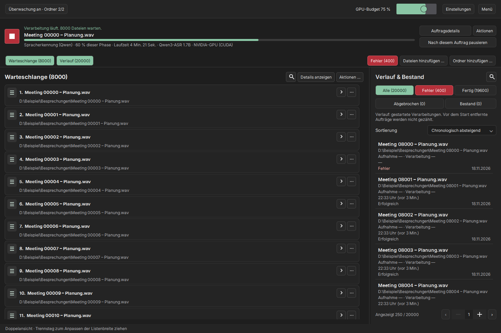
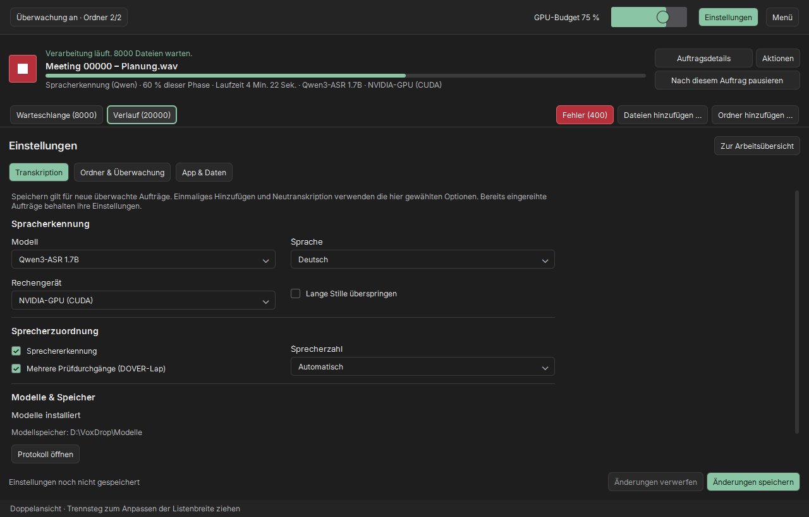

# Arbeitsübersicht ab Windows 1.4.0

Die freigegebene Neugestaltung trennt die tägliche Arbeit von der Einrichtung. Queue, Verlauf und aktueller Auftrag erhalten Platz; alle Einstellungen bleiben über drei Gruppen erreichbar. Die gemeinsame Implementierung liegt in `desktop/qml`, `desktop/controller.py` und `desktop/rows_model.py`. Der native Mac-Nachweis steht noch aus.

## Bedienung und vollständige Funktionszuordnung

| Bereich | Funktionen |
| --- | --- |
| Dauerhafte Kopfzeile | Tatsächlich gespeicherte Überwachung und Ordnerstatus; sofortiges CUDA-Arbeitsbudget; Einstellungen; App-Menü mit Fokus-/Automatikansicht, Protokoll, Über und vollständigem Beenden |
| Aktueller Auftrag | Fester 44×44-Play-/Stopp-Knopf; Zustand, Name, Phase, Fortschritt der Phase, Laufzeit, Modell, Gerät; Details; gezielter Auftragsabbruch; nach aktuellem Auftrag pausieren |
| Navigation | Queue- und globale Verlaufsanzahl; rote globale Fehleranzahl als Suchfilter zurücksetzender Shortcut; native Datei-/Ordnerauswahl für einmalige Aufträge |
| Warteschlange | Alle Aufträge; kompakte oder einzeln aufgeklappte Zeilen; Reihenfolge/Position; Drag-and-drop und vier Menüaktionen; Einzelentfernung; Details; Wildcards in Name/Pfad; gesamte Queue nach Bestätigung leeren |
| Verlauf und Bestand | Alle/Fehler/Fertig/Abgebrochen/Bestand mit Zählern; Sortierung; schnelle Name-/Pfadsuche; explizite TXT-Detailsuche mit Start und Stopp; 250 Einträge je Seite mit Seitenwahl; vollständige Auftragsdetails |
| Auftragsdetails | Alle bisherigen Messwerte und Originalpfad; ehrliche Bestands-/Wiederverwendungsangaben; Fehler; Wiederholen/Neutranskription; TXT mit OS-Standardprogramm öffnen; tatsächlichen Zielort in Explorer/Finder zeigen |
| Einstellungen: Transkription | Qwen/Whisper, Sprache automatisch/de/en, GPU/CPU, Stille, Sprecherzuordnung, DOVER-Lap, Sprecherzahl, Modellprüfung/-download und Speicherort |
| Einstellungen: Ordner & Überwachung | Sofortige Überwachung; beliebig viele Pfade, Prüfung/Auswahl/Entfernung; Rekursion; bedingter Zielunterordner; Scanintervall einschließlich bestehender benutzerdefinierter Werte |
| Einstellungen: App & Daten | Versions-/Codeinformation, sofortiger Anmeldestart, Fensterlebensdauer/Beenden, bestätigter vollständiger DB-/Cache-/Suchindexreset, Ordnerprüfung/Protokoll/Einrichtungsprüfung |
| Gemeinsame Dialoge | Batch-Konflikte mit priorisieren/neu/sofort/ignorieren/verwerfen; Netzwerkwarten abbrechen; verständliche Abbruch-/Resetbestätigung; vollständige lange Rückmeldungen scrollbar |

Ab 1.200 logischen Pixeln stehen Queue und Verlauf nebeneinander; der Trennsteg speichert die Verlaufsbreite. Darunter oder in gewählter Fokusansicht zeigt ein Reiter die ganze Liste. Das Mindestfenster 1.010×630 zeigt fünf vollständige kompakte Queuezeilen. Einstellungen haben einen sichtbaren Scrollbalken und eine feststehende Speichern-/Verwerfen-Zeile. Globale Verarbeitung bleibt auch dort steuerbar.

Pfad-/Sprach-/Modelländerungen sind Entwürfe bis **Änderungen speichern**. **Änderungen verwerfen** lädt den gespeicherten Stand. Überwachung, Anmeldestart und GPU-Budget sind ausdrücklich sofortige Aktionen und speichern keine fremden Entwurfsänderungen mit. Bereits eingereihte Aufträge behalten ihre eigenen Optionen. Der Kopf zeigt den gespeicherten Überwachungsstand, nicht ungespeicherte Pfade.

Stopp erhält Queue/Optionen und wartet auf das tatsächliche Ende der laufenden Erkennung; begonnener Export wird beendet. Ein gezielter Abbruch speichert vor Öffnen der Bestätigung die Auftrags-ID, damit ein zwischenzeitlich nächster Auftrag nicht versehentlich abgebrochen wird. Stopp bleibt auch während anderer Hintergrundaktionen erreichbar. X→Tray, Minimieren→Taskleiste und vollständiges Beenden bleiben unverändert.

## Große Listen und Suche

`StableRows`, ein `QAbstractListModel`, übermittelt Änderungen mit Einfüge-/Entferne-/Daten-Signalen. Ein Hintergrundsnapshot erzeugt nicht jede sichtbare Zeile neu. Scrollanker und pro Auftrag aufgeklappte Details bleiben beim Fertigwerden anderer Aufträge bestehen. Bei einer neuen Suche oder einem neuen Verlaufskontext wird bewusst neu positioniert.

Die Queue bleibt vollständig geladen und virtualisiert. Der Verlauf lädt jeweils höchstens 250 Ergebnisse; `watch_service.py status --offset N` ergänzt die vorhandenen Filter/Sortierungen. Zähler werden auf die ganze gefilterte Ergebnismenge angewendet; `global_history_counts` liefert unabhängig davon globale Zähler. Veraltete Antworten nach Seiten-/Suchwechsel werden verworfen. Überzählige letzte Seiten werden geklemmt. Die vorhandene inkrementelle TXT-Indexsuche bleibt eine explizite, abbrechbare Hintergrundaktion.

Keine neue Laufzeitabhängigkeit, kein Modell-/Lockfilewechsel und keine Datenbankschemamigration. Das Windows-Buildskript akzeptiert `--release-version 1.4.0`; `build-info.json` trennt die öffentliche Windows-Version vom unveränderten Bootstrap-/Runtime-Basisstand.

## Reproduzierbare Prüfung

```powershell
python -BEs -Xutf8 scripts/ci-tests.py run
python -BEs -Xutf8 scripts/check-workspace-ui.py --native --output <privater-pruefordner> --content
python -BEs -Xutf8 scripts/check-workspace-ui.py --native --scale 1.25 --output <anderer-pruefordner>
python -BEs -Xutf8 scripts/check-workspace-ui.py --native --scale 1.5 --output <weiterer-pruefordner>
```

Die Skripte verwenden isolierte Profile und synthetische Namen. `--app` prüft alternativ einen entpackten Programmordner. Ohne `--native` rendert das echte QML offscreen; CI führt auch den 8.000/20.000-Layoutcheck aus. Native Qt-Skalierung ist keine physische Änderung der Windows-Anzeigeeinstellung. Diese Tests ersetzen keine Bedienprüfung mit physischer Maus oder echte Explorer-/Tray-/Mac-Abnahme.

Lokaler nativer Windows-Test: 8.000 Queue- und 20.000 Verlaufseinträge, 100/125/150 % Qt-Skalierung, Mindest-/breite Fenster, alle Einstellungsgruppen samt unterem Scrollbereich, Details, Queue-Menü, Batch-Konflikte, Rückmeldung und Resetdialog. Native 100-%-Messung: initiales QML einschließlich Wartezeit 0,979 s; Queuewildcard einschließlich Renderwartezeit 0,098 s; zwei Verlaufsseiten/Zähler/Wildcard zusammen 0,254 s. Die explizite Detailsuche indizierte 20.000 synthetische TXT in 12,969 s, fand 206 Treffer ohne übersprungene Dateien und ließ sich abbrechen. RSS nach Layout und Suche rund 208 MiB. Dies sind lokale Einzelläufe, keine allgemeine Leistungszusage für SMB oder lange Transkripte.

Exakten funktionalen Code, Paket-/CUDA-Prüfung und Installationsnachweis dokumentieren der aktuelle Projektstatus und das Release-Manifest. Unveränderte sprachliche Modellgrenzen bleiben bestehen; dieser Layoutumbau behauptet keine Behebung sämtlicher ASR-Fehler.




